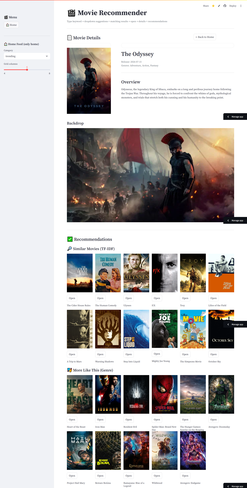
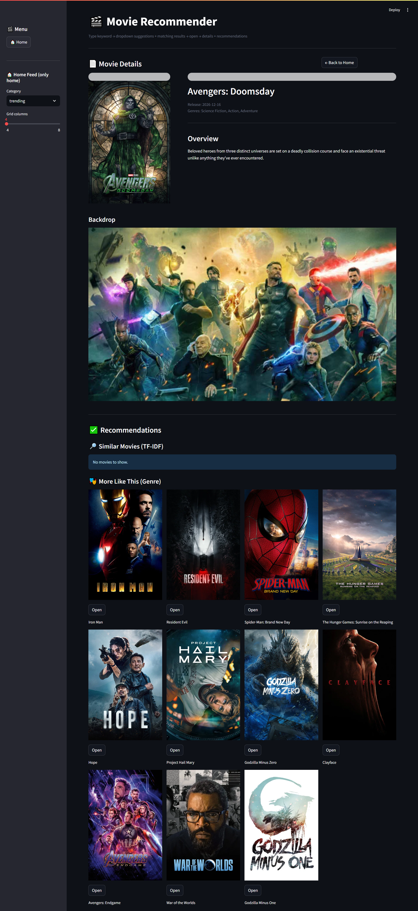
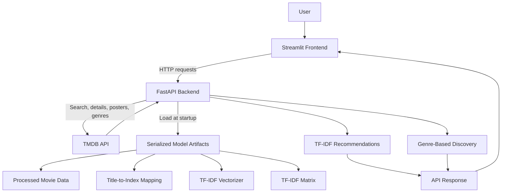

<div align="center">

# 🎬 Movie Recommendation System

**A content-based movie recommendation application built with TF-IDF, cosine similarity, FastAPI, Streamlit, and the TMDB API.**

[](https://movie-recomm-system-codesterabhi.streamlit.app/)
[](https://movie-recommendation-system-8486.onrender.com/docs)
[](https://www.python.org/)
[](https://scikit-learn.org/)

[**Live Application**](https://movie-recomm-system-codesterabhi.streamlit.app/) · [**API Documentation**](https://movie-recommendation-system-8486.onrender.com/docs) · [**GitHub Repository**](https://github.com/CodeSterAbhi/Movie_Recommendation_System)

</div>

---

## Table of Contents

- [Overview](#overview)
- [Live Demo](#live-demo)
- [Screenshots](#screenshots)
- [Features](#features)
- [Recommendation Approach](#recommendation-approach)
  - [Dataset and Preprocessing](#dataset-and-preprocessing)
  - [TF-IDF Feature Engineering](#tf-idf-feature-engineering)
  - [Similarity Calculation](#similarity-calculation)
  - [Genre-Based Discovery](#genre-based-discovery)
- [System Architecture](#system-architecture)
- [Application Workflow](#application-workflow)
- [Technology Stack](#technology-stack)
- [Repository Structure](#repository-structure)
- [Getting Started](#getting-started)
- [API Endpoints](#api-endpoints)
- [Model Artifacts](#model-artifacts)
- [Deployment](#deployment)
- [Configuration and Notes](#configuration-and-notes)
- [Limitations and Future Improvements](#limitations-and-future-improvements)
- [Acknowledgements](#acknowledgements)
- [License](#license)

---

## Overview

The **Movie Recommendation System** is a web application that lets users search for movies, inspect movie details, and discover similar titles through two distinct recommendation paths.

The application combines a locally prepared content-based recommendation model with live movie information from [The Movie Database (TMDB)](https://www.themoviedb.org/).

- **TF-IDF recommendations:** Finds similar titles from the locally processed dataset using TF-IDF vectors and cosine similarity.
- **Genre-based recommendations:** Uses the selected movie's first listed genre to discover popular movies through TMDB.

The application uses a decoupled architecture: Streamlit handles the user interface, while a FastAPI service handles API requests, TMDB integration, and loading and querying the local recommendation artifacts.

## Live Demo

| Component | Link | Description |
|---|---|---|
| Streamlit frontend | [Open application](https://movie-recomm-system-codesterabhi.streamlit.app/) | Search movies and explore recommendations |
| FastAPI Swagger UI | [Explore API](https://movie-recommendation-system-8486.onrender.com/docs) | Inspect and test backend endpoints |
| GitHub repository | [View source code](https://github.com/CodeSterAbhi/Movie_Recommendation_System) | Application code, notebook, dataset, and model artifacts |

> **Hosting note:** The backend runs on Render's free tier. After a period of inactivity, the service may spin down; the first request after that can take longer while it starts again.

## Screenshots

### Movie details — Light theme



### Movie details — Dark theme



The dark-theme screenshot also demonstrates the case where a selected movie is not matched in the local TF-IDF dataset: the TF-IDF section can be empty while TMDB genre-based recommendations remain available.

> Keep `odyssey_movie.png` and `doomsday_movie.png` in the repository root alongside this README for the images to render.

## Features

- Keyword-based movie search with matching suggestions.
- Movie detail pages with title, release date, genres, overview, poster, and backdrop.
- TF-IDF content-based recommendations from the local movie dataset.
- Genre-based movie discovery through TMDB.
- Home feed categories: trending, popular, top-rated, now-playing, and upcoming.
- Configurable movie poster grid layout.
- Separate frontend and backend services communicating over HTTP.
- Short-lived Streamlit caching for API helper responses.

## Recommendation Approach

The application exposes two recommendation methods. They are calculated independently and shown in separate sections; they are not currently merged into a single hybrid ranking.

### Dataset and Preprocessing

The notebook `movies.ipynb` loads `movies_metadata.csv` and performs the data preparation used to build the recommendation artifacts.

| Stage | Dataset dimensions / details |
|---|---|
| Raw CSV loaded into Pandas | 28,070 rows × 24 columns |
| After duplicate and missing-title removal | 28,057 movie records |
| Columns selected for the working dataset | `title`, `overview`, `genres`, `tagline`, `vote_average`, `popularity` |
| Final TF-IDF matrix | 28,057 rows × 50,000 features |

The notebook removes duplicate records and rows with a missing movie title. Missing `overview` and `tagline` values are filled with spaces. The genre field is parsed from its serialized representation and converted into a space-separated string of genre names.

### TF-IDF Feature Engineering

The text used to represent each movie is formed by concatenating exactly these three fields:

```python
df["tags"] = df["overview"] + " " + df["genres"] + " " + df["tagline"]
```

The combined text is preprocessed before vectorization:

1. Convert text to lowercase.
2. Remove punctuation using a regular expression.
3. Remove English stopwords using NLTK.
4. Lemmatize tokens using NLTK's `WordNetLemmatizer`.

The notebook then applies Scikit-learn's `TfidfVectorizer` with these exact parameters:

```python
TfidfVectorizer(
    max_features=50000,
    ngram_range=(1, 2),
    stop_words="english"
)
```

| Parameter | Configured value | Purpose |
|---|---|---|
| `max_features` | `50000` | Retain up to 50,000 features in the vocabulary |
| `ngram_range` | `(1, 2)` | Consider unigrams and bigrams |
| `stop_words` | `"english"` | Apply Scikit-learn's English stopword list during vectorization |

The notebook also performs English stopword removal during its NLTK preprocessing step. The vectorizer's `stop_words="english"` setting is retained as configured in the notebook.

The resulting TF-IDF matrix has **28,057 rows and 50,000 columns**, with **998,804 stored non-zero elements** in the saved notebook output.

### Similarity Calculation

When a title is requested, the backend:

1. Normalizes the title and looks it up in the saved title-to-index mapping.
2. Retrieves the corresponding row from the TF-IDF matrix.
3. Calculates its similarity against the movie vectors using the dot product of the sparse matrix and query vector.
4. Sorts the scores in descending order and excludes the selected movie.
5. Returns the highest-scoring titles.
6. Searches TMDB for matching titles to attach poster and movie metadata where available.

The notebook's recommendation function uses cosine similarity. For L2-normalized TF-IDF vectors, cosine similarity is equivalent to the dot product:

$$
\operatorname{cosine\_similarity}(A,B) =
\frac{A \cdot B}{\|A\|\|B\|}
$$

### Genre-Based Discovery

Genre recommendations use TMDB rather than the local TF-IDF matrix:

1. Fetch the selected movie's details from TMDB.
2. Extract its first listed genre.
3. Request popular movies associated with that genre from TMDB's Discover endpoint.
4. Exclude the selected movie from the returned recommendations.

Because this path uses TMDB, it can still return recommendations when a selected title is absent from the local dataset. In that case, the TF-IDF recommendation section may be empty.

## System Architecture



### Component Responsibilities

| Component | Responsibility |
|---|---|
| Streamlit (`app.py`) | Search interface, home feed, movie details, and recommendation display |
| FastAPI (`main.py`) | REST endpoints, TMDB communication, artifact loading, and recommendation logic |
| Local pickle artifacts | Store processed movie data, title-index mapping, fitted vectorizer, and TF-IDF matrix |
| TMDB API | Supply movie search results, details, images, and genre discovery |
| Render | Host the FastAPI backend |
| Streamlit Community Cloud | Host the Streamlit frontend |

## Application Workflow

1. The user opens the Streamlit application.
2. The frontend requests the selected home-feed category from FastAPI.
3. The user enters a movie keyword.
4. FastAPI queries TMDB and returns matching search results.
5. The user selects a movie from the suggestions or result grid.
6. The frontend requests the selected movie's details.
7. FastAPI retrieves movie metadata from TMDB.
8. The backend calculates TF-IDF recommendations using the local artifacts and fetches TMDB poster metadata for matching titles.
9. The backend separately requests genre-based recommendations from TMDB.
10. Streamlit displays the movie details and both recommendation sections.

## Technology Stack

| Area | Technologies |
|---|---|
| Language | Python |
| Frontend | Streamlit |
| Backend | FastAPI, Uvicorn |
| Machine learning | Scikit-learn, TF-IDF, cosine similarity |
| Data processing | Pandas, NumPy, SciPy |
| Text preprocessing | NLTK |
| HTTP communication | Requests, HTTPX |
| External movie data | TMDB API |
| Configuration | python-dotenv, environment variables, Streamlit Secrets |
| Model persistence | Pickle |
| Deployment | Render, Streamlit Community Cloud |
| Version control | Git, GitHub |

## Repository Structure

```text
Movie_Recommendation_System/
│
├── app.py                  # Streamlit frontend
├── main.py                 # FastAPI backend
│
├── movies.ipynb            # Data exploration, preprocessing, and model workflow
├── movies_metadata.csv     # Source movie metadata
│
├── df.pkl                  # Processed movie DataFrame
├── indices.pkl             # Movie title-to-index mapping
├── tfidf.pkl               # Fitted TF-IDF vectorizer
├── tfidf_matrix.pkl        # Precomputed TF-IDF matrix
│
├── requirements.txt        # Python dependencies
├── .python-version         # Python version configuration
├── runtime.txt             # Runtime configuration
├── .gitignore              # Git ignore rules
├── .env                    # Local environment variables (not committed)
│
├── odyssey_movie.png       # Light-theme application screenshot
├── doomsday_movie.png      # Dark-theme application screenshot
│
└── README.md               # Project documentation
```

`desktop.ini` and `.venv/` are local development files and should not be committed.

## Getting Started

### Prerequisites

- Python 3.11 recommended.
- Git and pip.
- A TMDB API key.
- The dataset and serialized `.pkl` artifacts included in the repository.

### 1. Clone the Repository

```bash
git clone https://github.com/CodeSterAbhi/Movie_Recommendation_System.git
cd Movie_Recommendation_System
```

### 2. Create and Activate a Virtual Environment

**Windows — Command Prompt:**

```bash
python -m venv .venv
.venv\Scripts\activate
```

**Windows — PowerShell:**

```powershell
python -m venv .venv
.venv\Scripts\Activate.ps1
```

**macOS / Linux:**

```bash
python3 -m venv .venv
source .venv/bin/activate
```

### 3. Install Dependencies

```bash
python -m pip install --upgrade pip
pip install -r requirements.txt
```

Use a Scikit-learn version compatible with the one used to serialize the saved artifacts. Pickle files containing Python and Scikit-learn objects are not guaranteed to be compatible across arbitrary library versions.

### 4. Configure Environment Variables

Create a `.env` file in the project root:

```env
TMDB_API_KEY=your_tmdb_api_key
API_BASE=http://127.0.0.1:8000
```

Replace `your_tmdb_api_key` with your own TMDB API key.

- FastAPI reads `TMDB_API_KEY` to authenticate requests to TMDB.
- Streamlit uses `API_BASE` to locate the FastAPI backend. If it is not set, the frontend defaults to `http://127.0.0.1:8000`.

Do not commit `.env` or expose your API key.

### 5. Start the FastAPI Backend

In the repository root, run:

```bash
uvicorn main:app --reload
```

The backend will be available at:

- API service: `http://127.0.0.1:8000`
- Swagger UI: `http://127.0.0.1:8000/docs`
- Health check: `http://127.0.0.1:8000/health`

Keep this terminal running.

### 6. Start the Streamlit Frontend

Open a second terminal, activate the same virtual environment, navigate to the repository root, and run:

```bash
streamlit run app.py
```

Open the local URL printed by Streamlit, usually `http://localhost:8501`.

## API Endpoints

| Method | Endpoint | Purpose |
|---|---|---|
| `GET` | `/health` | Check backend health |
| `GET` | `/home` | Retrieve movies for a home-feed category |
| `GET` | `/tmdb/search` | Search TMDB for matching movie titles |
| `GET` | `/movie/id/{tmdb_id}` | Retrieve details for a movie by TMDB ID |
| `GET` | `/recommend/genre` | Retrieve recommendations based on the movie's first genre |
| `GET` | `/recommend/tfidf` | Retrieve local TF-IDF recommendations by title |
| `GET` | `/movie/search` | Retrieve movie details and both recommendation groups |

### Example Requests

```http
GET /health
GET /home?category=trending&limit=24
GET /tmdb/search?query=avengers
GET /movie/id/123
GET /recommend/tfidf?title=Toy%20Story&top_n=10
GET /movie/search?query=Toy%20Story&tfidf_top_n=12&genre_limit=12
```

Replace `123` with a valid TMDB movie ID.

The deployed API can be explored and tested through [Swagger UI](https://movie-recommendation-system-8486.onrender.com/docs).

## Model Artifacts

The FastAPI backend loads the serialized files from the project directory during startup.

| Artifact | Contents / purpose |
|---|---|
| `df.pkl` | Processed DataFrame containing 28,057 movie records and the text fields used by the recommendation workflow |
| `indices.pkl` | Pandas Series mapping movie titles to row indices in the processed dataset |
| `tfidf.pkl` | Fitted Scikit-learn `TfidfVectorizer` configured with `max_features=50000`, `ngram_range=(1, 2)`, and `stop_words='english'` |
| `tfidf_matrix.pkl` | Sparse TF-IDF matrix with shape `(28057, 50000)` and 998,804 stored non-zero elements |

The matrix is built from the concatenated `overview`, `genres`, and `tagline` text after the notebook's preprocessing steps. The title index and matrix row positions must remain aligned.

These artifacts are committed to the repository so the deployed backend can load the precomputed recommendation data without rerunning the notebook at each service startup. If a required artifact is missing or incompatible, backend startup or recommendation requests may fail.

## Deployment

The project uses a split deployment architecture:

| Layer | Platform | Deployed resource |
|---|---|---|
| Frontend | Streamlit Community Cloud | [Movie Recommendation App](https://movie-recomm-system-codesterabhi.streamlit.app/) |
| Backend | Render | [FastAPI Swagger UI](https://movie-recommendation-system-8486.onrender.com/docs) |
| Source control | GitHub | [Project repository](https://github.com/CodeSterAbhi/Movie_Recommendation_System) |

### Cloud Configuration

**Render — backend environment variable**

```text
TMDB_API_KEY=your_tmdb_api_key
```

**Streamlit Community Cloud — App Settings → Secrets**

```toml
API_BASE = "https://movie-recommendation-system-8486.onrender.com"
```

The frontend sends requests to the deployed FastAPI service using this `API_BASE` value. Configure secrets through the hosting platforms' settings, not in committed source files.

## Configuration and Notes

- **TMDB access:** Search, movie details, images, and genre discovery require a valid TMDB API key on the backend.
- **Pickle compatibility:** Use compatible Python and dependency versions when loading the serialized artifacts.
- **Startup loading:** The backend loads the dataset and TF-IDF artifacts into memory when the application starts.
- **Caching:** The Streamlit API helper uses a 30-second cache.
- **External dependency:** TMDB-backed functionality depends on TMDB availability and API access.
- **Free-tier hosting:** Services may sleep or have resource limits. The first request after inactivity may be slower.

## Limitations and Future Improvements

- Add offline recommendation evaluation using ranking metrics such as Precision@K, Recall@K, MAP, or NDCG with an appropriate relevance dataset.
- Improve title matching to handle alternate titles, punctuation, and release-year differences.
- Display recommendation explanations, such as similarity scores or overlapping metadata.
- Experiment with additional content features, such as keywords, cast, and crew, where suitable data is available.
- Explore a hybrid approach if reliable user interaction or rating data becomes available.
- Add automated API tests, structured logging, and monitoring.
- Optimize similarity retrieval and caching as the dataset grows.

These are possible future improvements, not features currently implemented.

## Acknowledgements

- [The Movie Database (TMDB)](https://www.themoviedb.org/) for movie metadata, posters, backdrops, and discovery data.
- [Streamlit](https://streamlit.io/) for the interactive web application framework.
- [FastAPI](https://fastapi.tiangolo.com/) for the backend API framework.
- [Scikit-learn](https://scikit-learn.org/) for TF-IDF vectorization and machine-learning utilities.
- [NLTK](https://www.nltk.org/) for stopword processing and lemmatization.

This product uses the TMDB API but is not endorsed or certified by TMDB.

## License

This project is licensed under the **MIT License**. You may use, copy, modify, merge, publish, distribute, sublicense, and/or sell copies of the software, subject to the conditions in the [LICENSE](LICENSE) file.

---

<div align="center">

**Built by [CodeSterAbhi](https://github.com/CodeSterAbhi)**

[Live Application](https://movie-recomm-system-codesterabhi.streamlit.app/) · [GitHub Repository](https://github.com/CodeSterAbhi/Movie_Recommendation_System)

</div>
